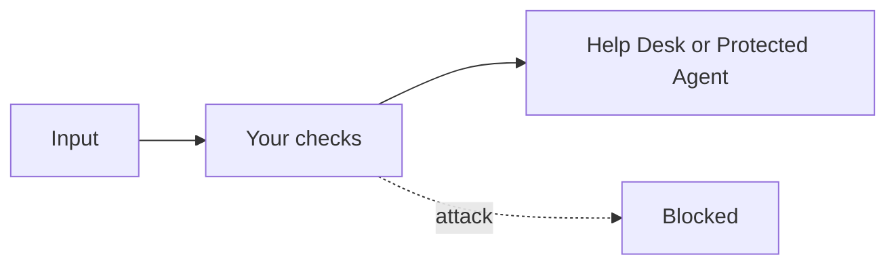
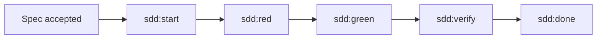

<a id="readme-top"></a>

<div align="center">
  <a href="https://ai-shield-delta.vercel.app">
    
  </a>

  <h1>ai-shield</h1>

  <p>
    <strong>An interactive prompt-injection defence game for LLM applications.</strong>
    <br />
    Can you stop every injection?
  </p>

  <p>
    <a href="https://ai-shield-delta.vercel.app"><strong>Play the game</strong></a>
    &middot;
    <a href="docs/README.md">Read the docs</a>
    &middot;
    <a href="https://github.com/terryong31/ai-shield/issues/new?template=bug_report.yml">Report a bug</a>
    &middot;
    <a href="https://github.com/terryong31/ai-shield/issues/new?template=feature_request.yml">Request a feature</a>
  </p>

[![CI][ci-shield]][ci-url]
[![CodeQL][codeql-shield]][codeql-url]
[![License: MIT][license-shield]](LICENSE)

</div>

<details>
  <summary>Table of contents</summary>
  <ol>
    <li><a href="#about-the-project">About the project</a></li>
    <li><a href="#getting-started">Getting started</a></li>
    <li><a href="#usage">Usage</a></li>
    <li><a href="#documentation">Documentation</a></li>
    <li><a href="#development">Development</a></li>
    <li><a href="#contributing">Contributing</a></li>
    <li><a href="#security">Security</a></li>
    <li><a href="#citation">Citation</a></li>
    <li><a href="#license">License</a></li>
    <li><a href="#acknowledgments">Acknowledgments</a></li>
  </ol>
</details>

## About the project

[![The defence board: checks on the left, Input and Help Desk on the right][board-screenshot]](https://ai-shield-delta.vercel.app)

Players wire checks on a node board to protect an LLM agent from waves of prompt
injections. Each wave gets a score for protection, helpfulness, tool use, tokens, speed
and cost.



The checks are Text cleaner, Word filter, Length limit, Secret scanner, ML filter, Jev,
Safety check, LLM review and Tool filter.

### Architecture

| Path | What | Stack |
| --- | --- | --- |
| [`packages/engine`](packages/engine) | **Engine** (`shield-engine`): board interpreter, checks, levels, AI agent, custom sandbox and scoring | Python 3.12, scikit-learn |
| [`apps/api`](apps/api) | **Gateway** (`shield-api`): players and quotas, runs, saved boards, leaderboard, payments and admin clearance | FastAPI, Supabase, Redis, Stripe |
| [`apps/web`](apps/web) | **Web client** (`@ai-shield/web`): main menu, defence board, plans, settings and admin console | Nuxt 4, Nuxt UI, Vue Flow |

The web client talks only to the gateway, through a committed
[OpenAPI contract](contracts/shield-api.openapi.json). The gateway holds no detection
logic: that is in the engine. See [Architecture](docs/explanation/architecture.md).

### Built with

[![Python][python-shield]][python-url]
[![FastAPI][fastapi-shield]][fastapi-url]
[![scikit-learn][sklearn-shield]][sklearn-url]
[![Nuxt][nuxt-shield]][nuxt-url]
[![Supabase][supabase-shield]][supabase-url]
[![Redis][redis-shield]][redis-url]
[![Stripe][stripe-shield]][stripe-url]
[![Vercel][vercel-shield]][vercel-url]

<p align="right">(<a href="#readme-top">back to top</a>)</p>

## Getting started

### Prerequisites

- [mise](https://mise.jdx.dev). It installs the pinned versions of the other tools.
- Docker, for local Supabase and Redis.
- Access to the Infisical project. If you do not have access, see
  [Manage secrets](docs/how-to/manage-secrets.md).

### Installation

1. Clone the repository.

   ```bash
   git clone https://github.com/terryong31/ai-shield.git
   cd ai-shield
   ```

2. Install the tools, the dependencies and the git hooks.

   ```bash
   mise install
   mise run setup
   ```

3. Log in to Infisical. Do this one time on each computer.

   ```bash
   infisical login
   ```

4. Start the gateway on port 8000 and the web client on port 3000.

   ```bash
   mise run dev
   ```

Open <http://localhost:3000>. The API documentation is at
<http://localhost:8000/api/v1/docs>. To stop all servers, run `mise stop`.

To run both apps in containers, use `mise run up`. Do not commit `.env` files.

<p align="right">(<a href="#readme-top">back to top</a>)</p>

## Usage

1. **Select a level.** The main menu (`/`) has 23 levels in three difficulties:

   | Difficulty | Goal |
   | --- | --- |
   | Easy | Classify prompts at a Help Desk |
   | Medium | Protect a modern AI agent |
   | Hard | Protect a budget model |

2. **Build a defence.** On the board (`/game`), drag checks from **Tools** and wire them
   between **Input** and the final node. Double-click a node to configure it.
3. **Run the wave.** Select **Run wave** to get a score. Signed-in players can save their
   board and get 5 attempts each day on Medium and Hard (anonymous players: 1, paid
   players: 300).
4. **Build your own level.** A 30-day pass (**Plans**) unlocks all levels and the
   **Custom** sandbox, with your own agent, dataset and model key.

Administrators use the console (`/_console`) to see the score statistics and to clear the
scoreboard. To create an administrator, run `mise run admin:create <email>`.

<p align="right">(<a href="#readme-top">back to top</a>)</p>

## Documentation

The documentation follows the [Diátaxis](https://diataxis.fr) framework.

| Learn | Do | Look up | Understand |
| --- | --- | --- | --- |
| [Tutorials](docs/tutorials/) | [How-to guides](docs/how-to/) | [Reference](docs/reference/) | [Explanation](docs/explanation/) |

For the bundled baseline classifier, see the [model card](packages/engine/MODEL_CARD.md).

<p align="right">(<a href="#readme-top">back to top</a>)</p>

## Development

Development is **spec-driven and test-driven**. Each behaviour change starts as a
[spec](specs/README.md). Each acceptance criterion has a permanent ID, and a test with
that ID must fail before production code can change.



| Command | What it does |
| --- | --- |
| `mise run test` | Run all unit tests |
| `mise run check` | Run the full gate before you push |
| `mise run contract` | Generate the OpenAPI contract and the web types |
| `mise run sdd:status` | Show the active cycle and the next step |
| `mise tasks` | List all tasks |

On a pull request, GitHub Actions runs the checks for the parts that changed. Vercel
deploys the web client and the gateway independently, and skips a project that did not
change. See [Work with CI and the git hooks](docs/how-to/work-with-ci-and-git-hooks.md) and
[Development process](docs/explanation/development-process.md).

<p align="right">(<a href="#readme-top">back to top</a>)</p>

## Contributing

Read [CONTRIBUTING.md](CONTRIBUTING.md) first. AI coding agents must also follow
[AGENTS.md](AGENTS.md). For the release history, see [CHANGELOG.md](CHANGELOG.md).

## Security

If you find a bypass or a vulnerability, follow [SECURITY.md](SECURITY.md). Do not open a
public issue.

## Citation

If you use this project in research, cite it with [CITATION.cff](CITATION.cff).

## License

Distributed under the [MIT License](LICENSE).

## Acknowledgments

The structure of this file is based on
[Best-README-Template](https://github.com/othneildrew/Best-README-Template).

<p align="right">(<a href="#readme-top">back to top</a>)</p>

[board-screenshot]: docs/assets/defence-board.png
[ci-shield]: https://github.com/terryong31/ai-shield/actions/workflows/ci.yml/badge.svg?branch=main
[ci-url]: https://github.com/terryong31/ai-shield/actions/workflows/ci.yml
[codeql-shield]: https://github.com/terryong31/ai-shield/actions/workflows/codeql.yml/badge.svg?branch=main
[codeql-url]: https://github.com/terryong31/ai-shield/actions/workflows/codeql.yml
[license-shield]: https://img.shields.io/badge/license-MIT-0b0b0b
[python-shield]: https://img.shields.io/badge/Python_3.12-0b0b0b?logo=python&logoColor=white
[python-url]: https://www.python.org
[fastapi-shield]: https://img.shields.io/badge/FastAPI-0b0b0b?logo=fastapi&logoColor=white
[fastapi-url]: https://fastapi.tiangolo.com
[sklearn-shield]: https://img.shields.io/badge/scikit--learn-0b0b0b?logo=scikitlearn&logoColor=white
[sklearn-url]: https://scikit-learn.org
[nuxt-shield]: https://img.shields.io/badge/Nuxt_4-0b0b0b?logo=nuxt&logoColor=white
[nuxt-url]: https://nuxt.com
[supabase-shield]: https://img.shields.io/badge/Supabase-0b0b0b?logo=supabase&logoColor=white
[supabase-url]: https://supabase.com
[redis-shield]: https://img.shields.io/badge/Redis-0b0b0b?logo=redis&logoColor=white
[redis-url]: https://redis.io
[stripe-shield]: https://img.shields.io/badge/Stripe-0b0b0b?logo=stripe&logoColor=white
[stripe-url]: https://stripe.com
[vercel-shield]: https://img.shields.io/badge/Vercel-0b0b0b?logo=vercel&logoColor=white
[vercel-url]: https://vercel.com
