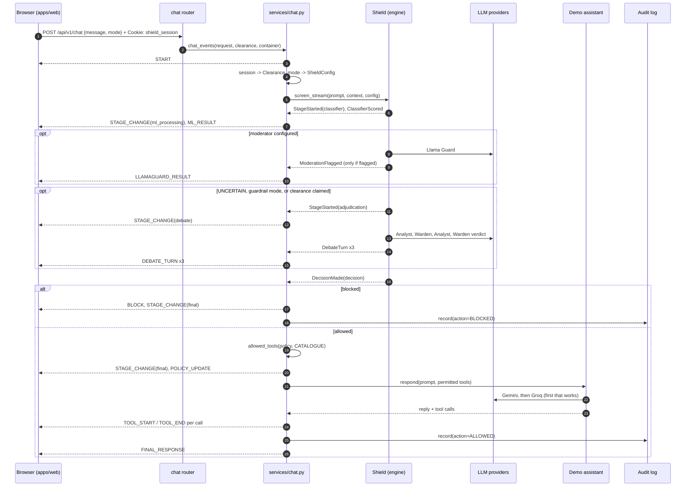

# Architecture

## Three deployables

`ai-shield` has three separately deployable parts in one repository:

| Part | Role | Talks to |
| --- | --- | --- |
| `packages/engine` (`shield-engine`) | The product: a Python library that decides whether a prompt may reach an LLM application (and with which tools), plus the `shield_engine.game` workflow graph evaluator and custom ML trainer | Nothing directly; everything external comes in through ports |
| `apps/api` (`shield-api`) | Gateway: puts the engine and game endpoints on HTTP, runs a protected demo assistant, manages clearance sessions, and owns persistence | Engine (in-process), Groq, Gemini, SQLite / Supabase |
| `apps/web` (`@ai-shield/web`) | Web client: game main menu (`/`), interactive node-based defence board (`/game`), and login-guarded admin console (`/_console`) | The gateway only, over the published HTTP contract |

They are separate because they have different audiences and lifetimes. The
engine is what someone embeds in their own application, benchmarks in a paper
or ships as a package; it must not drag in FastAPI, a database driver or a
frontend. The gateway and web client exist to demonstrate and exercise the
engine, and can be replaced without touching it. Before the split, detection
logic lived inside a chat route, mixed with streaming, logging and tool calls,
and could not be tested or evaluated on its own
([ADR 0002](decisions/0002-engine-gateway-split.md)).

The repository keeps them together so one change can span all three with one
review and one CI run ([ADR 0001](decisions/0001-monorepo-with-uv-and-bun-workspaces.md)).

## Ports and adapters in the engine

The engine's core, `Shield` in
[`pipeline.py`](../../packages/engine/src/shield_engine/pipeline.py), knows only
interfaces defined in [`ports.py`](../../packages/engine/src/shield_engine/ports.py):

```
                 ┌─────────────────────────── shield_engine ───────────────────────────┐
                 │                                                                      │
 prompt ───────▶ │  Shield ──▶ Classifier port ◀── ClassifierDetector (TF-IDF + SGD)     │
 Clearance ────▶ │    │                                  └── FeedbackStore port ◀── CSV / memory
                 │    ├──────▶ Moderator port ◀── LlamaGuardModerator ── ChatModel port ─┼──▶ GroqChatModel (adapter)
                 │    ├──────▶ Adjudicator port ◀── DebateAdjudicator ── ChatModel port ─┼──▶ any LLM
                 │    ▼                                                                 │
 Decision ◀───── │  Decision ──▶ allowed_tools(policy, ToolSpec[])                      │
                 └──────────────────────────────────────────────────────────────────────┘
```

The ports are structural `Protocol`s: any object with the right method
satisfies them, without inheritance or registration. Consequences:

- The engine's required dependencies are scikit-learn and joblib. Provider SDKs
  are optional extras (`shield-engine[groq]`) imported only from `adapters/`.
- Test doubles are trivial. `shield_engine.testing` ships deterministic ones so
  hosts can test integrations with no network or model.
- Hosts can swap any layer: a different classifier, a different moderator, a
  different adjudicator, a different LLM behind the same adjudicator.

Two ports sit at a lower level. `ChatModel` abstracts "an LLM that completes a
list of messages", so the moderator and adjudicator are written once and run on
any provider. `FeedbackStore` abstracts where reviewer labels live.

The engine never reads environment variables, never holds credentials, and
does no I/O at import time. Configuration arrives through constructors and
`ShieldConfig`.

## The composition root

Something has to decide which concrete adapters to use. In the gateway that is
exactly one function, `build_container()` in
[`container.py`](../../apps/api/src/shield_api/container.py). It reads
`Settings` and builds:

- the classifier via `load_baseline(feedback=CsvFeedbackStore(FEEDBACK_PATH))`
- `LlamaGuardModerator` and `DebateAdjudicator` over `GroqChatModel` if `GROQ_API_KEY` is set
- the assistant's chat models: Gemini if `GOOGLE_API_KEY` is set, then Groq
- `SupabaseAuditLog` if `SUPABASE_URL` and `SUPABASE_KEY` are set, else `SqliteAuditLog` at `SQLITE_PATH`

The resulting `Container` is stored on `app.state` and injected into routes
through a FastAPI dependency (`ContainerDep`). Tests build a `Container` from
fakes and pass it to `create_app(container)`, so no test patches module globals.

## Inside the gateway

| Layer | Modules | Rule |
| --- | --- | --- |
| Routers | `routers/*.py` (`health`, `screening`, `chat`, `feedback`, `audit`, `clearance`, `game`) | HTTP mapping only |
| Services | `services/chat.py`, `access.py`, `sessions.py`, `audit.py` | The `/chat` flow, session cookies to `Clearance`, request options to engine inputs, persistence |
| Demo | `demo/assistant.py`, `tools.py`, `gemini.py` | The protected application: an assistant and a simulated toolbox |
| Contract | `schemas.py` | Pydantic models exported to `contracts/shield-api.openapi.json` |

`services/access.py` and `services/sessions.py` are where credentials stop. A passphrase is exchanged once at `POST /api/v1/clearance` for an `HttpOnly` session cookie (`shield_session`, stored only as a SHA-256 hash in SQLite), which resolves to a `Clearance` (`NONE`, `DENIED`, `GRANTED`); a mode becomes a `ShieldConfig`. Nothing past this point sees the passphrase or session token.

## Request lifecycle of `POST /api/v1/chat`



Each event is written to the response as one JSON line as soon as it is
produced, so the browser animates the pipeline while it runs
([ADR 0005](decisions/0005-ndjson-event-stream.md)). If anything raises, the
stream ends with a generic `ERROR` event and the details go to the server log.

The engine decides; the host enforces. `Shield` returns a policy, and the
gateway turns it into a tool list with `allowed_tools()` before the assistant
sees any tool. The assistant cannot call a tool that is not in that list,
because it only receives the permitted names.

## Inside the web client

The browser talks only to the gateway
([ADR 0004](decisions/0004-frontend-talks-only-to-gateway.md)). All calls go
through [`useShieldApi()`](../../apps/web/app/composables/useShieldApi.ts), and
all shapes come from `app/types/api.gen.ts`, generated from the committed
OpenAPI contract. The NDJSON parsing and the reducer that folds events into UI
state are pure functions in
[`chatStream.ts`](../../apps/web/app/utils/chatStream.ts), tested without Vue.

## Related

- [Defense in depth](defense-in-depth.md) for why the layers are ordered as they are
- [Repository layout](../reference/repository-layout.md) for the dependency rules
- [HTTP API reference](../reference/http-api.md) for exact event shapes
