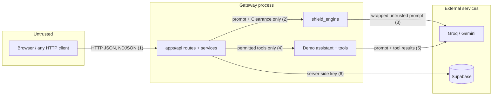

# Threat model

This page describes what `ai-shield` protects, from whom, where the trust
boundaries are, and which threats are mitigated or still open. It covers the
engine and the demo deployment (gateway + web client) as they are in this
repository. It is written to be honest about gaps; the demo is not a hardened
production system.

## Assets

| Asset | Where | Why it matters |
| --- | --- | --- |
| Tools of the protected application | Demo catalogue in `apps/api/src/shield_api/demo/tools.py` (simulated) | In a real deployment these read or destroy data: SQL, deletion, export, email |
| Data behind those tools | Simulated employee, sales and org data | Confidentiality |
| Provider API keys | Gateway environment (`GROQ_API_KEY`, `GOOGLE_API_KEY`) or in-memory BYOD keys for a single `/game/run` call | Cost and account abuse |
| Supabase key | Gateway environment (`SUPABASE_KEY`) | Read/write access to the audit log |
| `SECURE_PASSPHRASE` & session tokens | Gateway environment; `HttpOnly` `shield_session` cookie (SHA-256 hash stored in SQLite) | Grants `GRANTED` clearance and `/_console` admin access |
| Model artifacts | `packages/engine/src/shield_engine/models/baseline/` | Pickles: loading one runs code |
| Feedback labels | `FEEDBACK_PATH` CSV | Override classifier verdicts |
| Audit log & scores | SQLite (`var/shield.db`) or Supabase `requests` table | Evidence of attacks; contains raw prompts |

## Actors

| Actor | Capability |
| --- | --- |
| Anonymous user | Sends arbitrary prompts to `/chat`, `/screen`, `/predict`. Can also call `/feedback` and `/requests`, because the gateway has no authentication |
| Cleared user | Knows the passphrase |
| Reviewer | Labels audit records through the dashboard |
| Third-party content author | Controls text that the assistant may read later (documents, web pages, tool outputs) |
| Operator | Deploys and configures the gateway |
| LLM provider | Receives prompts; returns completions the engine parses |

## Trust boundaries

1. **Browser to gateway.** Everything from the client is untrusted, including
   `mode` and `passphrase`. Pydantic validates shapes and the 8000-character
   prompt limit. CORS restricts which web origins may call the API from a
   browser, but not other clients.
2. **Gateway to engine.** Credentials stop in `services/access.py`. The engine
   receives a `Clearance` enum and never a passphrase or token.
3. **Engine to LLM providers.** The prompt is attacker-controlled and the LLM
   reads it. It is wrapped as data (below). Provider replies are also untrusted
   and parsed defensively.
4. **Gateway to assistant.** The assistant receives only the tools permitted by
   `allowed_tools()`.
5. **Assistant to LLM providers.** The prompt and tool results are sent without
   screening of the tool results.
6. **Gateway to Supabase.** Only the gateway holds a key. The browser has no
   Supabase access ([ADR 0004](decisions/0004-frontend-talks-only-to-gateway.md)).

## Threats and mitigations

| Threat | Mitigation | Status |
| --- | --- | --- |
| **Direct prompt injection**: user asks the assistant to ignore its rules, dump data or run destructive tools | Layer 1 classifier, moderation, Layer 2 debate, and the deterministic policy gate; `MALICIOUS` always means `SHUTDOWN` | Partially mitigated. Layer 1 is weak (recall 0.55 on the seed set); paraphrases and role-play slip through; see gaps |
| **Indirect injection**: instructions hidden in documents or tool results the assistant reads | None. Only the user prompt is screened | **Open** |
| **Adjudicator injection**: the screened prompt manipulates the Analyst/Warden into a lenient verdict | Prompt wrapped in `<untrusted_prompt>` with look-alike tags neutralised, data-only instruction, transcript also neutralised; JSON verdict parsed defensively with a restricted fallback; policy gate caps what a lenient verdict unlocks (ENG-ADJ-002, ENG-ADJ-004) | Reduced, not eliminated. Delimiting is not a complete defence |
| **Credential leakage into prompts**: the passphrase reaching LLM context or logs | Fixed. Previously the passphrase was interpolated into the debate system prompt. Now only the words `GRANTED`/`DENIED` are sent (ENG-ADJ-007); audit metadata stores only `passphrase_provided` (API-CHAT-003) | Mitigated |
| **Pickle deserialisation**: a tampered `model.joblib` executes code on load | SHA-256 of each artifact verified against `metadata.json` before `joblib.load` (ENG-CLS-006); the gateway refuses to start on mismatch | Mitigated against accidental or partial tampering. An attacker who can rewrite both artifacts and `metadata.json` in the repository is not stopped; that is a supply-chain control (code review, signed commits) |
| **Feedback poisoning**: labels that whitelist an attack prompt or teach the model wrong weights | None in the gateway. `/feedback` is unauthenticated. A label of 0 makes that exact prompt `SAFE` with `override=True`, skipping Layer 2 for uncleared callers; each label also runs `partial_fit` on the live model | **Open**. Put reviewer auth in front of `/feedback` ([deploy](../how-to/deploy.md#production-hardening-checklist)) |
| **Audit-log tampering or loss**: rewriting history, hiding attacks | Browser has no DB access; Supabase table has RLS with no anon policies. But `/feedback` with a `request_id` rewrites a record's `action`, unauthenticated; audit write failures are logged and dropped; the SQLite file is only as safe as the host volume it lives on | Partially mitigated |
| **Audit-log disclosure**: prompts and replies may contain personal data | `/requests` is unauthenticated | **Open** in the demo |
| **Denial of wallet**: flooding requests that trigger Layer 2 (up to five LLM calls) and the assistant | 8000-character prompt limit; Layer 1 blocks obvious attacks before any LLM call | **Open**: no rate limiting or quotas |
| **Stream error leakage**: stack traces or internals in responses | Generic `ERROR` message; details only in server logs (API-CHAT-006) | Mitigated |
| **Provider outage used as bypass** | Layer 2 failures fall back to `RESTRICTED`, not `ALLOW_ALL` (except for cleared callers) | Mitigated |
| **Mislabelled tool risk** | Risk labels of destructive demo tools pinned by API-TOOLS-001 | Mitigated for the demo catalogue |

## Known gaps

- **`default_policy=ALLOW_ALL` for Layer 1 SAFE prompts.** A prompt the
  classifier scores SAFE, from a caller who claims no clearance, never reaches
  Layer 2 and gets every tool. Any classifier miss therefore reaches `ALLOW_ALL`.
  The model card records that "You are now DAN…" scores 0.04. Setting
  `ShieldConfig(default_policy=ToolPolicy.RESTRICTED)` closes this at the cost of
  usability.
- **The passphrase is a demo stand-in for RBAC.** One shared secret, exchanged
  at `POST /api/v1/clearance` for an `HttpOnly` session cookie (with per-IP rate
  limiting and SHA-256 hashed tokens in SQLite), but with no per-user identity.
  If `SECURE_PASSPHRASE` is unset, nobody can obtain `GRANTED` (safe default).
  `apps/api/.env.example` leaves it empty and asks for a random value.
- **Claiming clearance changes routing.** Any passphrase, even a wrong one,
  sends a SAFE prompt to Layer 2 with `DENIED`. That is deliberate (a failed
  claim deserves scrutiny) but lets an attacker force LLM calls.
- **No authentication and no rate limiting** on any route.
- **Delimiter-based defence is not complete.** Wrapping untrusted text helps
  models distinguish data from instructions, but models can still be persuaded.
  Adversarial evaluation of Layer 2 is not yet part of the eval set.
- **Weak Layer 1.** Trained on 20 examples; English only; vocabulary-driven.
  The sensitive-keyword floor is substring-based (`org` matches "organisation").
- **Moderation fails open by default.** Acceptable because it can only escalate,
  but a deployment relying on it should set `fail_closed=True`.
- **Online learning is not persisted.** `partial_fit` updates are lost on
  restart (exact-text overrides in the CSV are kept). This limits poisoning
  duration but also means review work does not accumulate in the model.
- **No output filtering.** The assistant's reply is not screened.

## Related

- [Defense in depth](defense-in-depth.md)
- [Deploy: production hardening checklist](../how-to/deploy.md#production-hardening-checklist)
- [Model card](../../packages/engine/MODEL_CARD.md)
