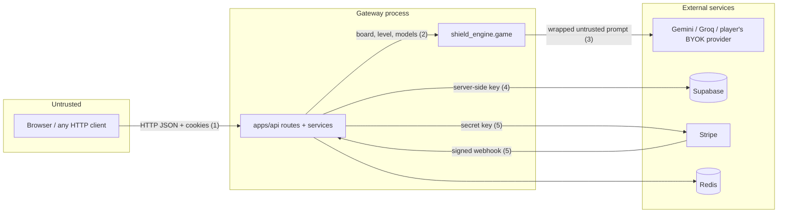

# Threat model

This page describes what the `ai-shield` game protects, from whom, where the
trust boundaries are, and which threats are mitigated or still open. It covers
the engine, gateway and web client as they are in this repository, and is
honest about gaps.

## Assets

| Asset | Where | Why it matters |
| --- | --- | --- |
| Provider API keys | Gateway environment (`GOOGLE_API_KEY`, `GROQ_API_KEY`) | Cost and account abuse: every agent-level wave calls a model |
| Players' own keys | Browser memory; sent with each custom sandbox `/game/run` call (spec 0022) | A leak spends the player's money |
| Stripe keys | Gateway environment (`STRIPE_SECRET_KEY`, `STRIPE_WEBHOOK_SECRET`) | Refunds and fake payment events |
| Infisical access | Infisical project (`dev`, `prod`) | Every secret above and below |
| Pass purchases | `players.purchases`, `players.accounts.paid_until`; Stripe holds the payments | Free access to the Paid tier; money owed to players |
| Supabase key | Gateway environment (`SUPABASE_KEY`) | Read/write access to all game data |
| Player accounts | Supabase Auth (passwords, email confirmation); `players.accounts` holds the profile (name, tier, pass end) | Account takeover |
| Session tokens | `shield_player_session` and admin `shield_session` cookies (`HttpOnly`); only SHA-256 hashes stored | Impersonation, admin access |
| Admin accounts | Supabase Auth users with `app_metadata.role = "admin"` | Grant admin clearance (`/_console`, clearing the scoreboard) |
| Leaderboard and saved boards | `game.scores`, `game.saved_boards` | Integrity of the competition; players' work |
| Daily quotas | `players.daily_usage` | Bound model spend per player |
| Model artifacts | `packages/engine/src/shield_engine/models/baseline/` | Pickles: loading one runs code |

## Actors

| Actor | Capability |
| --- | --- |
| Anonymous player | Gets an anonymous session; 1 wave run a day on agent levels and on boards with model checks; other Easy runs are unlimited |
| Signed-in player | Free (5 runs a day) or paid (300); saves boards; records scores; paid players run the custom sandbox with their own key |
| Admin | A Supabase user given the admin role by `mise run admin:create`; opens `/_console`; clears the scoreboard |
| Operator | Deploys and configures the gateway |
| LLM provider | Receives the agent prompt (with the attacker's text); returns completions the engine parses |

## Trust boundaries

1. **Browser to gateway.** Everything from the client is untrusted: boards,
   rules, datasets, custom agents, keys. Pydantic validates shapes and sizes;
   unknown fields are rejected on saves and BYOK models. CORS restricts which
   web origins may call the API with credentials, not other clients.
2. **Gateway to engine.** The engine receives the board, the level and model
   objects; never cookies, passwords or keys as strings in prompts.
3. **Engine to LLM providers.** Wave prompts are attacker-controlled by design.
   Each is wrapped with `wrap_untrusted()`, and replies are parsed defensively.
4. **Gateway to Supabase.** Only the gateway holds a key; RLS denies `anon` and
   `authenticated` ([ADR 0004](decisions/0004-frontend-talks-only-to-gateway.md)).
5. **Gateway and Stripe.** Card data never reaches the gateway. A webhook is trusted only with a valid,
   recent signature. The redirect from Stripe is not trusted.

## Threats and mitigations

| Threat | Mitigation | Status |
| --- | --- | --- |
| **Denial of wallet**: flooding agent runs | Daily quotas per tier (anonymous 1, free 5, paid 300), rate limits per address and session, and BotID on runs; Easy and Custom call no server model | Partially mitigated. The anonymous quota is per session, so clearing cookies gets a new one, up to 30 sessions an hour for each address |
| **Player key leakage** (custom sandbox) | The key arrives as a `SecretStr`, builds one client for one run and is dropped. Errors log only the exception type; provider error bodies are discarded. The length is checked in the router so validation errors cannot echo it. The save schema has no key field. The browser keeps it in a component ref, never in storage or the URL (API-SANDBOX-003, WEB-SANDBOX-002) | Mitigated |
| **SSRF through BYOK** | No URL field; providers are an allowlist with fixed HTTPS base URLs in `providers/byok.py`; unknown fields are rejected (API-SANDBOX-004) | Mitigated |
| **Agent prompt injection** beyond the game's intent (the attacker text steering the server-side model) | `wrap_untrusted()` delimiting, a per-run canary, tool allowlists, token budgets, and judging on the canary and tool calls rather than trusting the model | Reduced, not eliminated: the game exists because delimiting is not a complete defence |
| **Leaderboard tampering** | Scores are recorded only by the gateway from its own wave run, best per player and level; clearing needs admin clearance | Mitigated. Scores are owned by the player's email (spec 0025); scores from before that are keyed by display name |
| **Admin password guessing** | Per-address rate limit (`CLEARANCE_MAX_ATTEMPTS` in `CLEARANCE_WINDOW_MINUTES`) checked before Supabase is called, one generic `401` for every refusal, hashed session tokens | Mitigated. No second factor |
| **Player escalates to admin** | The role is read from `app_metadata`, which only the service key can write; `user_metadata` is ignored; a registered player's Supabase user has no role (API-CLEAR-015) | Mitigated |
| **Account takeover** | Supabase Auth checks passwords; random session tokens stored only as hashes, `HttpOnly` cookies; 10 failed sign-ins in 15 minutes for each email and 30 auth requests in 5 minutes for each address (spec 0043); confirmation and recovery links bound to the browser (spec 0047) | Mitigated. No second factor |
| **Registering someone else's email** | With Supabase, register signs nobody in until the emailed link is clicked; register and resend answer the same for every address (API-VERIFY-001, 002, 005) | Mitigated |
| **Fake payment event** | Signature check on the raw body with a 5-minute tolerance; the live or sandbox mode must match the key (API-BILL-003, 005) | Mitigated |
| **Paying less, or twice** | The server sets the price, and the paid amount is compared with the stored purchase; one open checkout for each player; a row lock grants one time (API-BILL-004, 012, 017) | Mitigated |
| **Money taken, nothing granted** | Webhook retries, `POST /billing/sync`, automatic refund for a deleted account, error log for other cases (API-BILL-014, 016, 017) | Mitigated |
| **Keeping access after a refund or chargeback** | Refund and dispute events remove the unused days (API-BILL-018 to 020) | Mitigated |
| **Free Paid tier in production** | None: production uses the Stripe sandbox, and test cards are public | Accepted until live keys are set |
| **Changed session hint cookie** | `shield_session_hint` is display data. The gateway ignores it, and it has no email (WEB-AUTH-012) | Mitigated |
| **Spoofed display names** | Control, bidirectional and zero-width characters are refused (API-NAME-004). Names are not unique | Partially mitigated |
| **Secrets in the repository** | Infisical holds the secrets; gitleaks scans commits and history; CodeQL and semgrep run on pull requests | Mitigated |
| **Pickle deserialisation** | SHA-256 of each artifact verified against `metadata.json` before `joblib.load` (ENG-CLS-006); startup fails on mismatch | Mitigated against accidental or partial tampering; a full rewrite in the repository is a supply-chain concern |
| **Oversized saves and datasets** | Saves limited to 60 nodes, 200 edges and 256 KB; datasets to 50 rows of 1,000 characters; ML training CSVs validated | Mitigated |
| **Error leakage** | Generic messages to clients; details in server logs only | Mitigated |
| **Docs and schema exposure** | Swagger UI and `/openapi.json` only with `APP_ENV=development`; production (the default) serves neither (API-DOCS-001) | Mitigated |

## Known gaps

- **Anonymous quota bypass.** Clearing cookies creates a new anonymous session
  and a fresh run, up to the limit for each address.
- **Email delivery.** Supabase's built-in mailer sends only a few emails an hour,
  and on newer projects only to team members. Real players need custom SMTP.
- **Sandbox payments in production.** A public test card gives the Paid tier ([Accept payments](../how-to/accept-payments.md)).
- **Early fraud warnings** from Stripe are not handled.
- **No admin second factor or instant revoke.** Removing the admin role stops new
  sign-ins; a session already open lasts until it expires or signs out.
- **Weak baseline classifier.** Trained on 20 examples; English only;
  vocabulary-driven. No game check uses it since spec 0038.

## Related

- [Architecture](architecture.md)
- [Deploy: production hardening checklist](../how-to/deploy.md#production-hardening-checklist)
- [Model card](../../packages/engine/MODEL_CARD.md)
