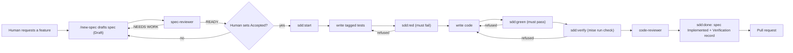

# Work with AI agents

The repository is set up so that AI coding agents, Claude Code in particular,
follow the same spec-driven, test-driven loop as people. This page shows how to
use that setup.

## What is in the repository

| Path | Purpose |
| --- | --- |
| [`AGENTS.md`](../../AGENTS.md) | Root instructions for any agent: commands, the mandatory spec + TDD loop, architecture rules, code style, definition of done, and what to ask before doing |
| [`packages/engine/AGENTS.md`](../../packages/engine/AGENTS.md), [`apps/api/AGENTS.md`](../../apps/api/AGENTS.md), [`apps/web/AGENTS.md`](../../apps/web/AGENTS.md) | Per-package maps and rules, added to the root rules |
| `CLAUDE.md` (root and each package) | One line, `@AGENTS.md`, so Claude Code loads the matching `AGENTS.md` |
| [`.claude/settings.json`](../../.claude/settings.json) | Shared Claude Code permissions and hooks |
| [`.claude/hooks/format.sh`](../../.claude/hooks/format.sh) | Formats each file after the agent edits it |
| `.claude/agents/` | Subagents: `spec-reviewer`, `test-author`, `code-reviewer` |
| `.claude/skills/` | Skills: `new-spec`, `tdd`, `run-eval` |

Personal overrides go in `.claude/settings.local.json`, which is git-ignored.

## Permissions

`.claude/settings.json` sets three lists:

| List | Contents |
| --- | --- |
| allow (no prompt) | `mise run *`, `mise tasks`, `uv run pytest/ruff/mypy`, `uv run shield-engine`, `uv run shield-api-export-openapi`, `uv run python scripts/*`, `uv sync`, `bun run test/lint/typecheck/build/contract`, `bun run --cwd apps/web *`, `bunx vitest`, `git status/diff/log` |
| ask (prompt each time) | `git push`, `uv add`, `bun add`, editing `.github/**` |
| deny | reading any `.env` or `.env.*` file, editing `apps/web/app/types/api.gen.ts` |

So the agent can run tests, linters and the full gate on its own, cannot see
your secrets, cannot hand-edit generated types, and must ask before adding
dependencies, touching CI or pushing.

## Formatting hook

After every `Edit` or `Write`, a `PostToolUse` hook runs `format.sh` on the
changed file:

- `*.py`: `ruff format`, then `ruff check --fix`
- `apps/web/**/*.ts` and `*.vue`: `eslint --fix` (skipping `api.gen.ts`)

It never blocks the agent (errors are ignored, 60-second timeout). It needs
`jq` on your `PATH` to read the hook payload; without `jq` it silently does nothing.

## Subagents

| Subagent | Model | Tools | Job |
| --- | --- | --- | --- |
| `spec-reviewer` | sonnet | Read, Grep, Glob | Reviews a draft `spec.md` against eight checks (problem, scope, testable criteria, unique IDs, edge cases, boundaries, evaluation impact, open questions). Reports PASS/FAIL per check and a READY / NEEDS WORK verdict. Does not edit |
| `test-author` | sonnet | Read, Grep, Glob, Edit, Write, Bash | Writes the failing test for each given criterion ID, tagged with the ID, and confirms it fails for the right reason. Only edits test files and `shield_engine/testing.py` |
| `code-reviewer` | opus | Read, Grep, Glob, Bash | Reviews the diff for traceability, boundaries, security, test quality, contract and docs; runs `mise run check`; groups findings as Blocking / Should fix / Nit. Does not edit |

Ask for one by name, for example: "Use the spec-reviewer subagent on
specs/0009-sensitive-keyword-password/spec.md."

## Skills

| Skill | Use when | What it does |
| --- | --- | --- |
| `/new-spec` | A behaviour change is requested and no spec covers it | Checks for an existing spec, runs `mise run spec:new`, reads the affected code, drafts `spec.md` (status stays `Draft`), adds the index row, runs `spec-reviewer`, then **stops** for human approval |
| `/tdd` | Implementing an `Accepted` spec | Drives the enforced cycle: `sdd:start`, tagged tests (itself or via `test-author`), `sdd:red`, code, `sdd:green`, docs, `sdd:verify`, `code-reviewer`, `sdd:done` |
| `/run-eval` | A change may affect detection quality | Runs `mise run eval` before and after, optionally the full pipeline (asks first; costs money), compares metrics, checks dataset digests match, updates the model card and spec |

## The loop

1. **Request.** Describe the problem, not the solution: "Prompts asking for
   passwords pass Layer 1 as SAFE. They should be reviewed."
2. **Draft.** Run `/new-spec`. The agent scaffolds the spec, fills it from the
   code and runs `spec-reviewer`. It cannot mark the spec accepted.
3. **Accept.** Read the spec, answer its open questions, and change
   `Status: Draft` to `Status: Accepted` yourself. This is the one human step:
   the spec is the contract the agent is held to.
4. **Implement.** Run `/tdd`. The agent runs the cycle in the table below. Each
   command prints `✓` and the next step, or `✗` and what is missing.
5. **Review.** Read the `code-reviewer` findings, the diff, and the new
   `## Verification` entry at the bottom of the spec.
6. **Pull request.** CI re-runs everything, including a check that every
   `Implemented` spec has a verification record.

| Command | Refuses unless |
| --- | --- |
| `mise run sdd:start <NNNN> [IDs…]` | the spec is `Accepted`/`Implemented` and the IDs exist in it |
| `mise run sdd:red` | every target ID has a tagged test, and each has at least one legitimately failing test |
| `mise run sdd:green` | every test of every target ID passes |
| `mise run sdd:verify` | `mise run check` passes |
| `mise run sdd:done` | the phase is `verified` (then it writes the spec's status and verification record) |
| `mise run sdd:status` / `sdd:abort` | always available |

A **legitimate failure** is an assertion failure, or a test module that
cannot import a `shield_engine`/`shield_api` symbol that doesn't exist yet. A
syntax error, a bad fixture or a missing third-party package is a broken
test, not red.

## Enforcement (hooks)

`.claude/settings.json` wires `scripts/sdd.py` into Claude Code:

| Hook | Effect |
| --- | --- |
| `PreToolUse` (Edit, Write, MultiEdit) | Test files need an active cycle. Production files (`packages/*/src`, `apps/api/src`, `apps/web/app`, `supabase/migrations`) stay locked until `sdd:red` has passed. Setting a spec to `Accepted` or `Implemented` is always denied. |
| `PreToolUse` (Bash) | Best effort: denies obvious shell writes (`sed -i`, `>`, `mv`…) to production paths while they are locked |
| `Stop` | Blocks ending a turn once in the `red`, `green` or `verified` phase, and names the next command |
| `SessionStart` | Tells the agent the current cycle and next step |

Denials start with `[SDD]` and name the command to run. Refactors that change
no behaviour use `mise run sdd:start --refactor "<reason>"`, which unlocks code
but still requires `sdd:verify`. The hooks guard against process drift; they
are not a security boundary. CI is the backstop.

To inspect a stuck cycle: `mise run sdd:status`. To throw it away: `mise run sdd:abort`.

## Tips

- Keep sessions scoped to one spec. The traceability check makes unrelated edits
  visible, and `AGENTS.md` tells the agent to mention unrelated issues rather
  than fix them.
- If the agent wants to weaken a test, change an `Accepted` criterion, or add a
  dependency, it has been told to ask. Say no unless the spec changes first.
- Point the agent at [reference docs](../README.md#reference) for exact APIs
  and at [explanation](../README.md#explanation) for design intent.

## Related

- [Development process](../explanation/development-process.md)
- [Write a spec](write-a-spec.md)
