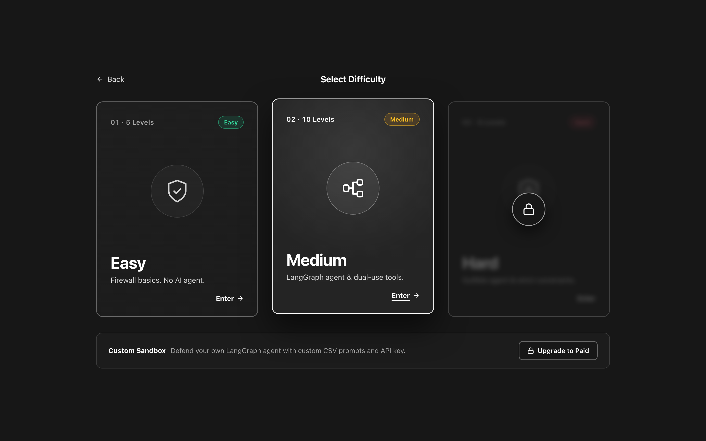
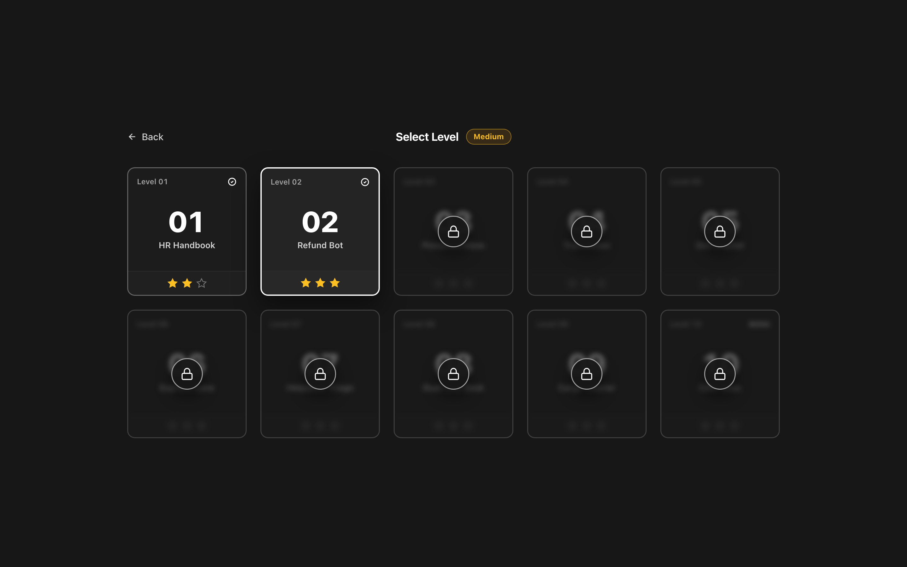

# 0040 — Minimal monochrome Level Select and in-game briefing UI

- **Status:** Implemented
- **Area:** WEB
- **Owner:** Terry Ong
- **Created:** 2026-11-19
- **Related:** [0039-campaign-levels-and-difficulty-leaderboard](../0039-campaign-levels-and-difficulty-leaderboard/spec.md), [0015-web-design-hygiene](../0015-web-design-hygiene/spec.md), [0022-game-custom-sandbox](../0022-game-custom-sandbox/spec.md), [0028-instant-leaderboard](../0028-instant-leaderboard/spec.md), [0037-langgraph-agent-and-tool-policy](../0037-langgraph-agent-and-tool-policy/spec.md)

## Problem

1. **Three hardcoded cards on `/` do not scale to 23 campaign levels, while cluttered dashboards break game focus and WCAG contrast.** `apps/web/app/pages/index.vue` currently renders 3 fixed cards (`easy`, `medium`, `hard`). With Spec `0039` expanding the game to **23 levels** across `Easy` (5), `Medium` (10), and `Hard` (8), players need a distraction-free, minimal, high-contrast **2-step indie game level select** matching `ai-shield`'s monochrome aesthetic rather than dense tables or crowded dashboards.
2. **The Main Menu leaderboard is still keyed per single level.** Players cannot view difficulty-category total high scores (`Easy`, `Medium`, `Hard`) backed by `GET /api/v1/game/leaderboard`.
3. **`/game` lacks campaign briefing and constraint feedback.** Players entering a level need to see Dual-Use tool distinctions, active Hard Constraints (locked palette nodes and node limits), Follow-Up Mastery targets, and `Solved` vs. `Mastered` outcomes after running a wave.

## Goals

- **Minimal Monochrome 2-Step Level Select (`/?view=levels`):**
  - **Step 1 — Select Difficulty (`/?view=levels`):** 3 spacious vertical `UPageCard` poster cards (`Easy` 5, `Medium` 10, `Hard` 8) on a clean solid monochrome surface with concise typography and geometric emblems (no progress bars, cleared counts, or points). Pro-locked categories (`Hard`) render blurred with a centered padlock overlay and remain clickable to open an **Upgrade to Pro** `UModal`, alongside the compact Custom Sandbox strip underneath.
  - **Step 2 — Select Level (`/?view=levels&difficulty=<category>`):** Generously padded centered tile grid (`5x1` Easy, `5x2` Medium, `4x2` Hard) with `Back` + `Select Level` + difficulty badge (no upper-right total score and no bottom difficulty switcher), a 3-star `<UInputRating>` footer on every tile, blurred + padlock overlay on Pro-locked tiles (clickable to open the Upgrade to Pro modal), and a clean `UModal` Mission Briefing when clicking any unlocked tile.
- Enforce **strict monochrome + selective accent color discipline**: 95% monochrome surfaces and typography; reserve color strictly for difficulty indicators (`Easy` / `Medium` / `Hard`) and high-attention rewards/alerts (such as the Mastery Star).
- Guarantee **WCAG 2.1 AA minimum (targeting AAA text contrast)**: `>= 4.5:1` contrast for normal text, `>= 3.0:1` for large text, icons, focus rings, and interactive borders (using the Main Menu's default Nuxt UI dark neutral `bg-default` surface `#171717` and elevated `#1c1c1c`/`#262626` cards, never pitch-black `#09090b`), and never rely on color alone to convey state (WCAG 1.4.1).
- Upgrade View 1 leaderboard on `/` to display aggregated high scores per difficulty (`GET /api/v1/game/leaderboard`), and upgrade `/game` with Mission Briefing, live disabled-check locks, node counter, Pro gate, and `Solved` / `Mastered` / `Next Level` results.

## Non-goals

- Engine evaluation rules, backend endpoints, database migrations, or server-side Pro enforcement (covered by [Spec 0039](../0039-campaign-levels-and-difficulty-leaderboard/spec.md)).
- Hidden test suites (`Run` vs. `Submit`) or percentile analytics (`Beats X%`), deferred past MVP.

## Behaviour

### 1. Minimal Monochrome Level Select Flow (`/?view=levels`)

The Level Select experience uses **two focused, clutter-free steps** built exclusively with Nuxt UI components (`UPageCard`, `UInputRating`, `UCard`, `UBadge`, `UButton`, `UModal`, `UEmpty`) using **Nuxt UI's default sans typography only** (never `font-mono` or `Roboto`) and generous negative space:

#### Step 1 — Difficulty Category Select (`/?view=levels`)

- **Header:** Centered `Select Difficulty` heading with left `Back` (`UButton variant="link" icon="i-lucide-arrow-left"`) on a clean solid monochrome `bg-default` surface (no tiled background lines and no top-right score clutter).
- **3 Vertical `UPageCard` Poster Cards (`spotlight`, `outline` variant — no progress bar, no cleared count, no points, and no harsh internal divider lines):**
  - **Top row:** Clean sans index (`01 · 5 Levels`, `02 · 10 Levels`, `03 · 8 Levels`) on left + single semantic difficulty `UBadge` (`Easy`, `Medium`, `Hard`) on right.
  - **Center emblem:** Generous negative space centering a subtle circular outline with a monochrome Lucide geometric icon (`i-lucide-shield-check` for Easy, `i-lucide-workflow` for Medium, padlock-shield for Hard).
  - **Bottom stack:** Bold display title (`Easy` / `Medium` / `Hard`), concise 1-line subtitle (`Firewall basics. No AI agent.` / `LangGraph agent & dual-use tools.` / `Gullible agent & strict constraints.`), and subtle right-aligned `Enter ->` cue on unlocked cards.
  - **Spotlight hover state:** Hovering illuminates unlocked cards with Nuxt UI's cursor `spotlight` glow, highlighted border, and subtle elevation.
  - **Locked Pro state (`Hard` for non-paid players):** No `"Pro"` text label; instead, the card interior is **blurred (`blur-sm opacity-35`)** with a high-contrast centered circular `i-lucide-lock` overlay and remains **clickable**, opening the **Upgrade to Pro** `UModal` (`#header/#body/#footer`, using Nuxt UI's native icon-only `i-lucide-x` close button in the header with no `"Close"` text word) informing the player they need a Pro plan with a `View Plans` `UButton` (`to="/plans"`).
- **Custom Sandbox Strip:** Understated horizontal `UCard` below the 3 poster cards preserving Spec `0022` `customModeAccess(session)` logic cleanly.

#### Step 2 — Minimal Level Tile Grid (`/?view=levels&difficulty=easy|medium|hard`)

- **Minimal Header Only:** Left `Back` button returning to Step 1 + centered `Select Level` heading paired with a single semantic difficulty `UBadge` (`Easy` / `Medium` / `Hard`) on a clean solid monochrome `bg-default` surface. **No upper-right total score and no bottom difficulty switcher.**
- **Centered Spacious Tile Grid (`5` tiles on Easy, `5x2` on Medium, `4x2` on Hard):**
  - Each tile shows clean high-contrast typography, stage number (`01`..`10`), level title, and a centered **3-star `<UInputRating>` (`:length="3"`, `readonly`, `color="warning"`, `size="sm"`)** in its footer strip:
    - Star calculation: `stars = (won ? 1 : 0) + (medal === 'gold' ? 1 : 0) + (mastered ? 1 : 0)` (`0`..`3` stars).
    - **Unlocked Tile:** `Level <NN>` top-left kicker + completion check icon (`i-lucide-check-circle-2` if cleared) or `Boss` label on sector finale (`easy-5`, `medium-10`, `hard-8`), large bold stage number + level title, and 3-star `UInputRating` footer (`★★★` for cleared + gold + mastered).
    - **Pro Locked Tile:** No `"PRO LOCKED"` label; renders the tile's real interior (`Level <NN>`, stage number, title, empty 3-star rating) **blurred underneath (`blur-[4px] opacity-35`)** with a centered high-contrast circular `i-lucide-lock` overlay, and clicking it opens the **Upgrade to Pro** `UModal` linking to `/plans`.
- **Click-to-Launch Mission Briefing Modal (`UModal` with `#header/#body/#footer`):**
  - Clicking any unlocked tile opens a compact Mission Briefing `UModal` (using Nuxt UI's native icon-only `i-lucide-x` close button in the header with no `"Close"` text word) showing level summary, Protected Asset, Agent tier & numbered Tool Loadout (`Safe`, `Dual-Use`, `Restricted`), Hard Constraint (if active), Mastery Star objective, and primary CTA (`Play Level ->` navigating to `/game?level=<id>`).

#### WCAG 2.1 AA/AAA Contrast & Design-Hygiene Guarantees (Spec `0015`)

- **Text & Icon Contrast:** Primary foreground (`text-highlighted`) achieves `>= 15:1`, secondary copy (`text-default`/`text-muted` tuned via high-contrast classes) stays `>= 7:1` on body copy and never drops below `4.5:1` for labels/kickers.
- **Interactive Boundaries (WCAG 1.4.11):** Tile outlines, card borders, progress tracks, lock icons, and focus indicators maintain `>= 3.0:1` contrast against adjacent dark surfaces.
- **Non-Color State Redundancy (WCAG 1.4.1):** Every state pairs labels/icons with shape differences (Star vs. Check vs. Open vs. Lock icon), never color alone.
- **Selective Color Budget:** Monochrome surfaces, borders, buttons, and typography throughout; color appears only on difficulty pills (`Easy`/`Medium`/`Hard`) and high-attention Mastery stars or error/constraint warnings.
- **Spec `0015` Compliance & Typography:** Strict Nuxt UI components (`UPageCard`, `UInputRating`, `UCard`, `UButton`, `UBadge`, `UModal` `#header/#body/#footer`, `UTable`, `UEmpty`) using Nuxt UI's default sans font stack (`font-sans`, zero `font-mono` or `Roboto`), zero raw Tailwind palette classes (`WEB-UI-001`), zero native HTML controls/tables (`WEB-UI-002`), zero emojis or `\u2014` em-dashes (`WEB-UI-003`), and `color="error"` string literal reserved strictly for dangerous `UButton` actions (`WEB-UI-005`).

### 2. Main Menu Leaderboard (`View 1` on `/`)

- Replaces single-level score tabs with difficulty category tabs: `Easy`, `Medium`, and `Hard`.
- Calls `GET /api/v1/game/leaderboard?difficulty=<DifficultyCategory>` (and refreshes automatically on SSE `leaderboard` events from `/api/v1/game/scores/stream`).
- `UTable` columns: `Rank`, `Player`, `Total Score` (e.g., `46,820 / 50,000`), `Cleared` (`5/5`), `Mastered` (`4/5`), `Avg Speed` (`14.2 ms`), `Cost` (`\$0.0000`).
- Empty leaderboard renders `UEmpty` (`title="No scores yet"`).

### 3. In-Game Campaign UX (`/game`)

- **Mission Briefing button & modal (`UModal` with `#header/#body/#footer`):** Shows mission summary, protected asset, agent tier (`Classification-only`, `Standard LangGraph Agent`, `Gullible LangGraph Agent`), numbered tools (`Tool 1..N`) with `Safe` / `Restricted` / `Dual-Use` badges, active Hard Constraints, and the Follow-Up Mastery target.
- **Live palette & node-limit enforcement:**
  - Any check kind listed in `level.constraints.disabled_checks` is disabled in the left tool palette (`:draggable="false"`) with a lock badge and `"Disabled in this level"` `UTooltip`.
  - When `level.constraints.max_check_nodes` is set, the board toolbar displays a live counter (`3 / 5 nodes`) comparing placed check nodes (excluding Input and Assistant) against the limit and warns before running if exceeded.
- **Direct-URL Pro Lock Gate:**
  - If an `anonymous` or `free` player visits `/game?level=<pro-level-id>`, `/game` renders an explicit `UEmpty` / `UCard` lock gate (`Pro level` explanation + `Upgrade to Pro` linking to `/plans` + `Back to Levels` linking to `/?view=levels`).
- **Run Results Modal Updates:**
  - When `waveScore.constraint_violations` is non-empty, displays each runtime SLA violation cleanly in a `UAlert` alongside `won=false`.
  - When `waveScore.follow_up_passed` is true, highlights `Mastered` (`i-lucide-star`).
  - When `waveScore.won` is true and `waveScore.follow_up_passed` is false, displays `waveScore.follow_up_feedback` so players know how to earn the Mastery Star.
  - Footer includes `Next Level` (advances to next sequential level if unlocked, or links to `/plans` when locked) and `Back to Levels` (`/?view=levels&difficulty=...`).

## Acceptance criteria

- **WEB-CAMP-001**: Given Step 1 of Level Select (`/?view=levels`), when rendered on a solid monochrome surface with the 23-level catalog and player tier, then it displays 3 tall monochrome `UPageCard` spotlight poster cards (`Easy` 5, `Medium` 10, `Hard` 8) with centered geometric emblems, difficulty badges, concise subtitles, and inline `Enter` cues without progress bars, cleared counts, or points, using Nuxt UI's default sans typography (no `font-mono`); Pro-only locked difficulties (`Hard`) render blurred with a centered padlock overlay and open an **Upgrade to Pro** `UModal` (`to="/plans"`) when clicked, alongside the Spec `0022` Custom Sandbox strip.
- **WEB-CAMP-002**: Given Step 2 of Level Select (`/?view=levels&difficulty=<Easy|Medium|Hard>`), when rendered on a solid monochrome surface, then it displays only the minimal top header (`Back`, `Select Level` + difficulty badge — with no upper-right total score and no bottom difficulty switcher), the centered numbered tile grid (`5`, `10`, or `8` tiles with large numbers, 3-star `<UInputRating>` footers driven by `stars = (won ? 1 : 0) + (medal === 'gold' ? 1 : 0) + (mastered ? 1 : 0)`, high-contrast WCAG borders/icons, and blurred + padlock overlays on Pro-locked tiles), clicking an unlocked tile opens a `UModal` Mission Briefing (`#header/#body/#footer`) with tools, constraints, Mastery target, and `Play Level` CTA, and clicking a Pro-locked tile opens the **Upgrade to Pro** `UModal` (`to="/plans"`).
- **WEB-CAMP-003**: Given the Main Menu leaderboard on `/`, when loading or receiving an SSE leaderboard update, then it fetches `GET /api/v1/game/leaderboard` and renders each difficulty tab (`Easy`, `Medium`, `Hard`) showing aggregated `total_score`, `levels_solved / levels_total`, `levels_mastered`, `avg_latency_ms`, and `total_cost_usd`.
- **WEB-CAMP-004**: Given `/game` for any of the 23 levels, when loaded and run, then it displays the Mission Briefing (tools with `Dual-Use` badges, Hard Constraints, Mastery Star objective), locks palette nodes listed in `constraints.disabled_checks`, displays a live check-node counter against `constraints.max_check_nodes`, shows a Pro lock gate linking to `/plans` if a non-paid user visits a `pro` level, and shows `constraint_violations`, `Mastered` status / `follow_up_feedback`, and `Next Level` in the Run Results modal (no `Back to Levels` button there; the header `Return` goes back, at the owner's request).
- **WEB-CAMP-005**: Given all new and modified files under `apps/web/app/`, when checked against Spec `0015` design-hygiene and WCAG 2.1 AA contrast standards, then only Nuxt UI and Vue Flow components and semantic tokens are used (`UEmpty`, `UTable`, `UCard`, `UModal` `#header/#body/#footer` slots), with `>= 4.5:1` text contrast, `>= 3.0:1` interactive borders/icons, non-color state redundancy, zero raw Tailwind palette classes, zero native HTML controls, zero emojis or em-dashes, and zero literal `color="error"` attributes on non-`UButton` elements.
- **WEB-CAMP-006**: Given `/game` on a level whose `constraints.disabled_checks` lists a check, when the Tools palette renders, then that card is locked the same way as a sign-in-locked card (dimmed, `cursor-not-allowed`, `aria-disabled`, not draggable, hover overlay `Disabled in this level`) and its footer shows a `i-lucide-ban` icon with `Disabled` instead of latency and cost, with no separate ban badge in its header. (Added at the owner's request.)
- **WEB-CAMP-007**: Given `/game` on an introductory level (`easy-1`, `easy-2`, `easy-3`), when the board first loads for a player who has not finished or skipped that level's tour in this browser, then a guided tour opens, driven by Nuxt UI `useTour` and a single `UPopover`, with the steps from `levelTourSteps(levelId)` (`app/utils/levelTours.ts`): a centred intro, the taught palette cards, the placed nodes and anchors, the Test bar and `Run wave`, each pointing at a `[data-tour="…"]` target (a step whose node is not on the board yet points at the canvas). Each step shows its position, `Back`, `Next` (or `Finish` on the last step) and `Skip`; finishing or skipping remembers the tour under `tourSeenKey(levelId)`, and a `Guide` button in the header replays it. Other levels have no tour and no `Guide` button. (Added at the owner's request.)

## Security & privacy considerations

- Client-side Pro locks only guide navigation to `/plans`; actual access enforcement on `/run` and `/saves/{level_id}` stays server-side in `apps/api` (Spec `0039`).
- All leaderboard and player progress reads go through `useShieldApi()` without exposing player emails in leaderboard payloads.

## Evaluation impact

- None on engine scoring; strictly web UI presentation over Spec `0039` catalog, progress, and leaderboard APIs.

## Open questions

- None.

## Verification

### 2026-11-19 · commit 2a0b84f (+ uncommitted changes)

- Criteria: WEB-CAMP-001, WEB-CAMP-002, WEB-CAMP-003, WEB-CAMP-004, WEB-CAMP-005
- Red: 5 failing test(s) before implementation (`minimal monochrome level select and campaign briefing UI (spec 0040) [WEB-CAMP-001] renders 3 vertical UPageCard difficulty poster cards (Easy 5, Medium 10, Hard 8) with blurred padlock on locked Hard and no progress bar or score clutter`, `minimal monochrome level select and campaign briefing UI (spec 0040) [WEB-CAMP-002] renders Step 2 numbered level tiles with 3-star UInputRating footers, blurred padlock on Pro-locked tiles, and opens Mission Briefing or Upgrade to Pro modals`, `minimal monochrome level select and campaign briefing UI (spec 0040) [WEB-CAMP-003] fetches difficulty-aggregated leaderboard entries for Easy, Medium, and Hard on the main menu`)
- Green: 5 passing test(s)
- Gate: `mise run check` passed

### 2026-11-19 · commit 2a0b84f (+ uncommitted changes)

- Criteria: WEB-CAMP-001, WEB-CAMP-002
- Red: 2 failing test(s) before implementation (`minimal monochrome level select and campaign briefing UI (spec 0040) [WEB-CAMP-001] renders 3 vertical UPageCard difficulty poster cards (Easy 5, Medium 10, Hard 8) with blurred padlock on locked Hard and no progress bar or score clutter`, `minimal monochrome level select and campaign briefing UI (spec 0040) [WEB-CAMP-002] renders Step 2 numbered level tiles with 3-star UInputRating footers, blurred padlock on Pro-locked tiles, and opens Mission Briefing or Upgrade to Pro modals`)
- Green: 2 passing test(s)
- Gate: `mise run check` passed

### 2026-11-21 · commit 2a0b84f (+ uncommitted changes)

- Criteria: WEB-CAMP-006
- Red: 1 failing test(s) before implementation (`minimal monochrome level select and campaign briefing UI (spec 0040) [WEB-CAMP-006] locks level-disabled palette cards like sign-in-locked cards`)
- Green: 1 passing test(s)
- Gate: `mise run check` passed

### 2026-11-21 · commit 2a0b84f (+ uncommitted changes)

- Criteria: WEB-CAMP-007
- Red: 1 failing test(s) before implementation (`/Users/terryong/Desktop/nuxt-projects/ai-shield/apps/web/test/levelTours.test.ts`)
- Green: 2 passing test(s)
- Gate: `mise run check` passed
